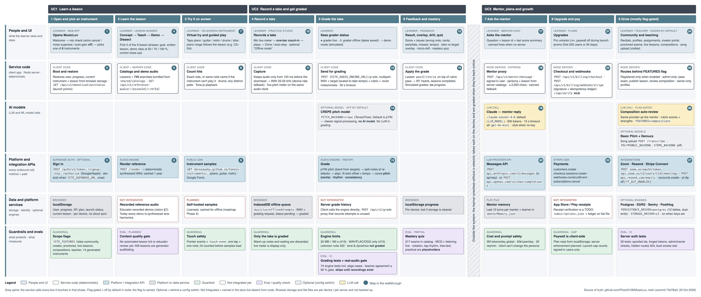

## Guardrails and evals

### Guardrails

What protects learners, data and cost today. Gaps are listed as gaps.

| Guardrail | What it prevents | Where it is enforced | Default / switch |
|---|---|---|---|
| Verified identity | Impersonating another learner with a made-up user id | `server/src/authMiddleware.ts` — Supabase JWT (HS256) only | On when `SUPABASE_JWT_SECRET` set; production refuses to boot without it |
| Route authorization | Passing your own exam, publishing lessons, editing others' profiles | `server/src/authz.ts` + `httpRoutes.ts` (requireUser / requireSelfOrAdmin / requireAdmin) | Always on; admin = `ADMIN_TOKEN` |
| Hidden features | Unfinished, unsecured features being reachable | `client/src/lib/features.ts`, `server/src/features.ts` | Off; `VITE_FEATURES` / `FEATURES` |
| Honest grading | Fake scores shown as real; fake scores earning progress | `client/src/components/PracticeStudio.tsx`, `mocks/api.ts` | Always on; demo mode only when no engine URL |
| Take-only capture | Warm-up notes and waiting time being graded | `client/src/audio/mic.ts`, `audio/countIn.ts` | Always on |
| Engine input limits | Huge or undecodable uploads, bad lesson data crashing the grader | `audio-engine/main.py` (413 / 415 / 422) | 20 MB, 180 s; `AUDIO_ENGINE_MAX_UPLOAD_MB`, `AUDIO_ENGINE_MAX_SECONDS` |
| LLM cost guards | A runaway bill from the mentor | `server/src/llm/costGuards.ts` | 2M tokens/day global (`LLM_GLOBAL_TOKENS_PER_DAY`), 50k/user/day, 20 req/min, 2 concurrent per mentor |
| Prompt safety | Callers rewriting the mentor's system prompt | `httpRoutes.ts` mentor route — persona and lesson from server catalogs; 2,000-char cap | Always on |
| Rate limits | Flooding grading or chat | `server/src/rateLimiter.ts` | Grade 60/min per caller, mentor 30/min per user |
| Payment integrity | Forged or replayed Stripe events | `server/src/billingService.ts` — signature check + webhook ledger | On when `STRIPE_WEBHOOK_SECRET` set |
| Launch-cap integrity | Exhausting the free-seat promo with fake ids | `/api/v1/monetization/seen` requires a signed-in user | Always on |
| CORS | Other websites calling the engine or server | `audio-engine/main.py`, `server/src/index.ts` | `AUDIO_ENGINE_CORS_ORIGINS`, `CORS_ORIGINS` (localhost:5173) |
| Secrets | Keys in the browser | LLM, Stripe, Zoom, Resend keys are server-side env only | — |
| Gap: paywall | Free users opening paid levels | Client-side only (localStorage) | Server enforcement planned (Phase 3) |
| Gap: storage | Data loss, no per-user isolation in a database | Flat JSON files on one server; browser storage per device | Supabase + RLS planned (Phase 3) |
| Gap: PII and audio retention | Keeping learner recordings longer than needed | Takes stay in the browser; no retention policy yet | Planned |

### Evals and quality gates

What measures whether the product is right, and whether each check is live, partial or planned.

| Eval | What it measures | When it runs | Threshold | Status |
|---|---|---|---|---|
| Grading edge-case suite | Repeated notes, flats, late start, tempo, cents error, vibrato, claps, silence, bad input | CI (`audio-engine/tests`, 74 tests) | All pass | Live |
| Real-audio agreement gate | Engine pass/fail vs a music teacher on real recordings | CI + release (`tests/test_real_corpus.py`, `scripts/eval_corpus.py`) | ≥ 90 % agreement, ≤ 5 % false fails | Partial — harness ready, no recordings yet |
| Grading latency | Time to grade a take | Measured manually | < 2 s p95 (roadmap) | Partial — 30 s take ≈ 2.4 s on a laptop |
| Server security tests | Spoofing, forged/expired tokens, admin and owner checks, hidden routes, persona injection, boot check | CI (`server/test`, 32 tests) | All pass | Live |
| Server boot smoke test | The server starts and answers `/api/v1/health` | CI | Up within 30 s | Live |
| Client unit tests | Note maths, keyboard range, grading mode, tempo scaling, pass rules, progress | CI (`client`, 25 tests) | All pass | Live |
| Typecheck + build | Client and server compile; client bundles | CI | No errors | Live |
| Mastery quizzes | Learner understanding per lesson | Runtime (217 exams in catalog) | Per-exam pass threshold | Partial — 4 of 6 question types are placeholders |
| Mentor answer quality | Whether mentor replies are correct and helpful | — | — | Planned — no eval set |
| Composition auto-review quality | LLM review vs human reviewer | — | — | Planned (feature hidden) |
| Lesson definition of done | Every lesson has all 9 phases, audio, quiz, drills (vision §10) | — | — | Planned — no automated check |
| Learner outcomes | Retention, practice minutes, pass rates | PostHog when `POSTHOG_API_KEY` set | — | Partial — events wired, no dashboard |

---

## MusicLuv — end-to-end workflow

Three learner journeys — learn a lesson, record and get graded, then mentor, plans and growth — showing every screen, service, AI model, outside API, data store, guardrail and eval, as built in the code today.

Source of truth: github.com/Phani3108/MusicLuv, main (commit 74d78a3, 29 Oct 2026) · Full readout with every table: [readout.html](readout.html) (open locally or download).

| | |
|---|---|
| **Scope** | Web app (React/Vite), Node server, Python audio engine. Phone = mobile browser; native Capacitor apps are not set up yet. |
| **Source of truth** | github.com/Phani3108/MusicLuv · main · commit 74d78a3 · 29 Oct 2026 |
| **Planned items** | From docs/product-vision.md, docs/platform-roadmap.md and the Phase 0 audit plan — drawn as Not integrated / Planned, never as live. |
| **Prepared by** | Phani · 29 Oct 2026 |

### The flow, step by step

_Numbers match the badges in the diagram._

**UC1 · Open and pick an instrument**

1. The learner opens the web app, runs a short mic check (browser echo cancelling, noise suppression and auto-gain are switched off because they distort music), and picks an instrument. Eight hand-authored instruments are shown; 14 generated ones are hidden.
2. The app restores the learner's place from browser storage (user, progress, current instrument and lesson) and asks the server for the launch-promo status (`GET /api/v1/monetization/status`).
3. Sign-in is optional. When Supabase is configured the app signs in through Supabase Auth (email, magic link, Google or Apple); otherwise it uses an anonymous device id.

**UC1 · Learn the lesson**

4. The lesson runner walks the first four of nine phases: what you're learning, the written lesson, demo clips at 50/75/100 % speed, and close-ups of each instrument control.
5. Lesson text, exercises (745) and drills are bundled into the app from the shared catalogs. Demo audio is requested from the server (`GET /api/v1/reference-audio/:lessonId`).
6. The server asks the audio engine to synthesize the demo (`POST /render`). It is a computer-generated tone, not a recorded musician — recorded demos are not integrated yet.

**UC1 · Try it on screen**

7. The learner plays the on-screen instrument to find the lesson's notes. The keyboard range follows the lesson, so left-hand and bass lessons are playable.
8. The app counts a hit on the exact note, or on the same note name when the on-screen instrument can't reach that octave; for drums any distinct pads count. Sound comes from Tone.js.
9. Piano, guitar and violin samples load from a public GitHub Pages CDN (tonejs-instruments). Self-hosted, licensed samples are planned.

**UC2 · Record a take**

10. The learner starts the exercise: the mic opens with a live level meter, a one-bar count-in clicks, then they play. The take ends automatically or when they tap Done. Offline mode saves the take on the device instead of grading it.
11. Audio is kept only from just before the downbeat, so warm-up notes never reach the grader, and is packed as a WAV file. The live pitch meter runs in the browser and is display-only.

**UC2 · Grade the take**

12. The app sends the take, the target notes (stretched to the take's tempo), the rubric and the mode (notes, or onsets for claps, drums and tabla) to the audio engine (`POST /grade`, 30-second timeout). A health check drives the live / offline / demo status chip.
13. The engine finds the pitch frame by frame (pYIN), splits notes where they are re-struck, lines the take up with the target while allowing for a late start and a different tempo, and scores pitch in cents, rhythm and consistency. Tone and dynamics are reported as not graded.
14. No AI model is used by default. The CREPE neural pitch model can replace pYIN with `PITCH_BACKEND=crepe`. Offline takes are graded the same way when the device comes back online.

**UC2 · Feedback and mastery**

15. The learner sees the score, a plain list of what to fix, their take overlaid on the target, a short corrective drill, and the lesson's mastery quiz.
16. The lesson's own pass rules are applied on top of the rubric, then XP, hearts and completed lessons are updated in browser storage. A simulated (demo-mode) grade never changes progress.

**UC3 · Ask the mentor**

17. The learner asks the mentor a question in the chat panel; the app sends the message with the lesson id and a summary of the last score.
18. The server checks the learner is signed in, limits them to 30 messages a minute, builds the mentor's persona and lesson context from its own catalogs (the client can't rewrite it), and caps the message at 2,000 characters.
19. Claude writes a 2–5 sentence reply in the mentor's voice with one concrete next step (`claude-sonnet-4-6` by default, 300-token cap). Without an API key a stub answers; if the call fails a canned line is used.
20. The call goes to Anthropic's Messages API (or OpenAI's chat API if that provider is configured). The last 10 turns are remembered per mentor and learner on the server.

**UC3 · Upgrade and pay**

21. Level 4 and above need the Pro plan; during the launch promo (first 200 users or 90 days) everything is unlocked.
22. The server starts a Stripe Checkout for the signed-in user and updates the subscription from Stripe's signed webhook, ignoring duplicates. App Store / Play receipt verification is a stub.
23. Stripe calls: create customer, create checkout session, verify webhook signature, cancel subscription.

**UC3 · Grow (mostly flag-gated)**

24. Community recitals, profiles, teacher assignments, the creator portal, proctored exams, live 1:1 lessons and composition review are hidden until the core loop is proven. Song upload is visible.
25. Their server routes exist only when switched on with `FEATURES`. Passing an exam, publishing a creator lesson and reviewing a composition are admin-only; profiles and assignments are owner-only.
26. When compositions are switched on, uploaded pieces get an automatic first review from the same LLM provider, which a human reviewer can override.
27. Integrations used by these features: Zoom (meeting links for exams and lessons), Resend (emails), Stripe Connect (creator payouts). URL import with yt-dlp is off.

<b>Data and history calls</b>

- **Read on every visit:** browser localStorage — user, progress, XP, hearts, plan, launch status, current lesson (`client/src/atoms`).
- **Written per take:** last grade and completed lessons to localStorage; offline takes (WAV + request) to IndexedDB `musicluv/offlineAttempts`.
- **Server flat files** (`MUSICLUV_DATA_DIR`): progress, mentor memory (last 10 turns), subscriptions, Stripe ledgers, launch state, users, quests, community data. One server only; not backed up.
- **Optional Postgres dual-write** (`PERSISTENCE_DRIVER=postgres`, 12 tables in `server/src/persistence/migrate.ts`): progress and attempts mirrored; flat file stays the source of truth.
- **Not integrated:** server-side grade history (the `/api/v1/grade` proxy is unused by the app), recorded reference audio, cross-device sync, App Store / Play receipts.

<b>LLM calls</b>

| Prompt / function | Model | When it runs | What it produces | Switch |
|---|---|---|---|---|
| `answerAsMentor` (`server/src/llm/mentorService.ts`) | `claude-sonnet-4-6` (alt `gpt-4o-mini`; stub) | Learner sends a mentor message | 2–5 sentence reply in persona, one next action, ≤ 300 tokens | `LLM_PROVIDER`, `ANTHROPIC_API_KEY`, `LLM_MODEL` |
| `reviewComposition` (`server/src/llm/compositionReview.ts`) | Same provider | Composition uploaded | Rubric scores, strengths, improvements, suggested status | Flag-gated: `FEATURES=compositions` |

<b>Embedding models</b>

| Model | Used for | Where it runs |
|---|---|---|
| None | No embeddings or vector search in the code | — |

<b>Other ML models</b>

| Model | Used for | Default / switch |
|---|---|---|
| pYIN (librosa) | Pitch tracking for grading — classic signal processing | Default |
| CREPE (TensorFlow) | Neural pitch tracking for grading | Off — `PITCH_BACKEND=crepe` |
| Basic Pitch (Spotify) | Chord/polyphonic transcription for song upload | Off — `POLYPHONIC_BACKEND=basic_pitch` |
| Demucs (Meta) | Separating an instrument from a song | Off — `STEMS_BACKEND=demucs` |

<b>API calls and integrations</b>

| System | Call | Purpose | Auth |
|---|---|---|---|
| MusicLuv audio engine | `POST /grade`, `POST /render`, `POST /transcribe`, `GET /health` | Grade takes, synthesize demos, song upload | None (CORS-limited) |
| MusicLuv server | `/api/v1/*` (mentor, billing, progress, reference audio, quests, experts, flagged community routes) | Everything that needs a server | Supabase JWT (dev: device id) |
| Anthropic | `POST https://api.anthropic.com/v1/messages` | Mentor replies, composition review | `x-api-key` |
| OpenAI (alternative) | `POST https://api.openai.com/v1/chat/completions` | Same, if configured | Bearer key |
| Supabase Auth | `/auth/v1/token`, `/signup`, `/otp`, `/authorize`, `/recover`, `/logout` | Sign-in | Anon key |
| Stripe | customers, checkout.sessions, webhooks, subscriptions, accounts, accountLinks | Subscriptions, creator payouts | Secret key + webhook secret |
| Zoom | `POST zoom.us/oauth/token`, `POST api.zoom.us/v2/users/{id}/meetings` | Meeting links (flag-gated features) | Server-to-server OAuth |
| Resend | `POST https://api.resend.com/emails` | Welcome, certificate, digest emails | API key |
| PostHog / Sentry | SDKs (`https://us.i.posthog.com`) | Analytics, error tracking | Keys, optional |
| S3 / Cloudflare R2 | Signed PUT (SigV4) | Composition uploads | Access keys, `STORAGE_DRIVER=s3` |
| tonejs-instruments CDN, Google Fonts | `GET` from the browser | Instrument samples, fonts | Public |
| Not integrated | Purchase-order-style history, App Store / Play receipt APIs, yt-dlp ingest | — | — |

<b>Tech stack</b>

| Layer | Components and versions |
|---|---|
| Web client | React 18, Vite 5, TypeScript 5.5, Jotai 2, Tailwind 3, Tone.js 15, @tonejs/midi |
| Mobile | Capacitor 6 config only (iOS/Android projects not generated) |
| Server | Node 22, Express 4, tsx, multer, stripe 17, pg 8, @sentry/node 8, posthog-node 4 |
| Audio engine | Python 3.10–3.12, FastAPI, uvicorn, librosa 0.11, numpy 1.26, scipy, soundfile |
| AI | Anthropic Messages API (raw fetch), optional OpenAI; optional CREPE, Basic Pitch, Demucs |
| Shared | TypeScript catalogs in `shared/catalogs` (lessons, 745 exercises, 217 exams, mentors, rubrics) |
| CI | GitHub Actions: client typecheck/test/build, server typecheck/test/boot, engine pytest |

<b>Switches</b>

| Env flag | Effect | Default |
|---|---|---|
| `VITE_AUDIO_ENGINE_URL` | Real grading; without it the app is in demo mode | unset (demo) |
| `VITE_SERVER_URL` | Mentor chat, launch status | unset |
| `VITE_FEATURES` / `FEATURES` | Show / register hidden features | empty (hidden) |
| `SUPABASE_JWT_SECRET` | Verified identity; required in production | unset (dev device id) |
| `STRICT_AUTH` | Reject all non-public requests without identity | false |
| `LLM_PROVIDER`, `ANTHROPIC_API_KEY`, `LLM_MODEL` | Real mentor LLM | stub |
| `LLM_GLOBAL_TOKENS_PER_DAY` | Daily LLM token cap | 2,000,000 |
| `PITCH_BACKEND`, `POLYPHONIC_BACKEND`, `STEMS_BACKEND` | Optional ML models | pyin / none / none |
| `PERSISTENCE_DRIVER`, `DATABASE_URL` | Postgres dual-write | flat file |
| `STORAGE_DRIVER` | Upload storage | local |
| `STRIPE_SECRET_KEY`, `STRIPE_WEBHOOK_SECRET` | Payments | unset |
| `YT_DLP_ENABLED` | Import songs from a URL | false |

